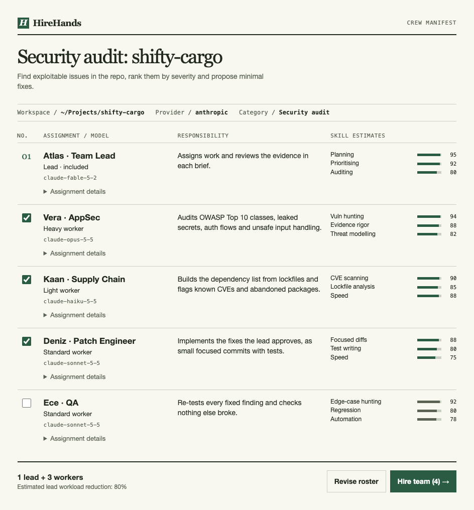
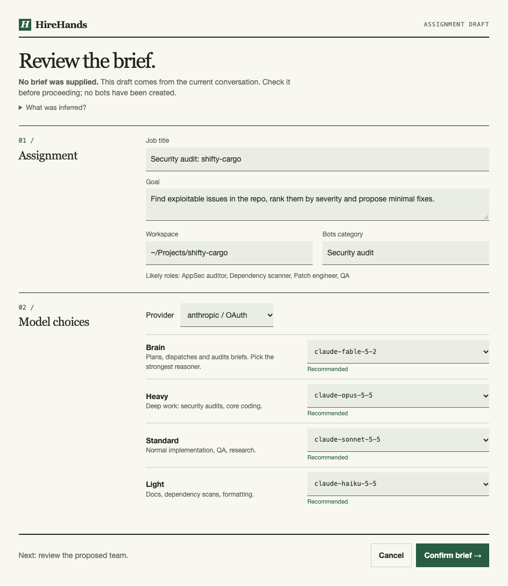

# HireHands

**One slash command to hire an AI team in [Hermes Agent](https://github.com/NousResearch/hermes-agent) Bot Mode.**

Type `/hirehands <job>` in any Bot chat. HireHands designs a small team for that job, shows it in a
crew manifest with RPG-style skill ratings, and on one click creates the Bots: a **lead "brain"** that only plans,
dispatches and lightly audits, plus **specialist workers** that do the actual work. They all land in
one Bots category named after the job.



## How to Install on Hermes Agent

Paste this prompt into your Hermes Agent chat:

```text
Install HireHands in my current Hermes profile. Run:
hermes skills install MrHakan/hermes-hirehands/skills/hirehands
Then verify that hirehands appears in `hermes skills list`. If the install is blocked, tell me why instead of forcing it. Don't create a team yet.
```

Once installed, open a new Bot Chat and type `/hirehands`. Prefer the terminal? See [Manual installation](#manual-installation).

## Why

Building a multi-agent workflow in Hermes by hand means creating each Bot, picking its model,
writing its prompt and filing it somewhere. HireHands does that in one step and gives the team a
working protocol:

- **The brain never does the work.** It does not write code or read the codebase. It hands out
  tasks with `message_agent`, decides from the briefs it gets back, and only spot-checks the evidence
  a brief cites (a quoted `file:line`, one quoted command, `git diff --stat`).
- **Workers report in a fixed brief format.** Status, findings by severity, evidence, changes, next
  step, blockers, confidence. A brief without evidence is sent back.
- **Risky actions stay gated.** Deleting, `git push`, deploying, outside messages and system changes
  need your approval before any worker does them.

## How it works

```
/hirehands <job>   ─▶ design team ─▶ hiring board ─▶ [Hire team] ─▶ Bots created in one category
/hirehands         ─▶ infer job from the chat ─▶ ⚠ setup screen (job + model picker) ─▶ [Confirm] ─▶ …
```

1. **Provider-aware models.** HireHands reads the provider of the Bot you are talking to and whether
   you are on a subscription (OAuth) or an API key, then picks a model per tier from the models that
   provider actually lists:

   | Tier | Anthropic | OpenAI Codex* |
   |---|---|---|
   | Brain | `claude-fable-5-2` → `claude-opus-5-5` | `gpt-6.2-sol` |
   | Heavy (security, core coding) | `claude-opus-5-5` | `gpt-6.2-sol` |
   | Standard (implementation, QA, research) | `claude-sonnet-5-5` | `gpt-6.2-astra` |
   | Light (docs, dependency scans) | `claude-haiku-5-5` | `gpt-6-luna` |

   \*The Codex tier ranking is a best guess. Edit `LADDERS` in `scripts/hirehands.py` to change it.
   Unknown providers fall back to the Bot's current model.

2. **Hiring board.** Compare assignments, models and skill estimates in one list. Expand a row for the reason to hire, perks and remaining ratings. Tick the workers you want and press **Hire team**, or choose **Revise roster**.

3. **Hire.** Each member becomes a Hermes profile (a Bot) with its model pinned, a generated
   `SOUL.md`, and Bot Mode metadata (title, avatar, category). The lead is pinned to the top. The bot
   to bot hop limit is raised to 10 so the lead can run several dispatch rounds per message, and the
   workspace becomes each Bot's terminal folder.

### No brief? Confirm first

`/hirehands` on its own does not guess silently. It reads the conversation, infers the job, and
shows a setup screen with a warning, the inferred job (editable), the reasons it inferred it, and a
model picker with a recommendation for every tier. Nothing is designed or created until you press
**Confirm**.



## Manual installation

Requires Hermes Agent with Bot Mode (the desktop app) on macOS or Linux.

```bash
git clone https://github.com/MrHakan/hermes-hirehands.git
mkdir -p ~/.hermes/skills/autonomous-ai-agents
cp -R hermes-hirehands/skills/hirehands ~/.hermes/skills/autonomous-ai-agents/
```

Make `/hirehands` available in every Bot, not only the default one:

```bash
HPY=$(sed -n 's/^exec \([^ ]*python3\) .*/\1/p' "$(command -v hermes)")
"$HPY" ~/.hermes/skills/autonomous-ai-agents/hirehands/scripts/hirehands.py link
```

`link` symlinks the skill into each profile's `skills/` folder. Run it again after hiring if you
want the new Bots to have the command too. Open a new chat (or run `/reload-skills`) to pick it up.

## Use

```
/hirehands check ~/Projects/my-app for security holes and fix the critical ones
```

Then open the Bots tab, find the new category, open the lead (gold hexagon, pinned) and give it the
job. Want everyone in one room? Create a group chat from that category in the desktop app.

Team files live in `~/.hermes/hirehands/<slug>/`: `team.json`, `board.html`, `ledger.md` (the lead's
decision log), plus `drafts/<draft>/job.json` and `drafts/<draft>/setup.html` for each setup preview.

### Script reference

```bash
hirehands.py detect               # provider, billing, per-tier picks for the current profile
hirehands.py models               # every connected provider with models and recommendations
hirehands.py setup <job.json>     # setup screen for the no-brief path
hirehands.py plan  <team.json>    # validate and render the hiring board
hirehands.py hire  <team.json> [--only sec,qa] [--dry-run]
hirehands.py status <team.json>   # which members already exist
hirehands.py link                 # make /hirehands available in every profile
```

See [`examples/`](examples) for a full `team.json` and `job.json`, and
[`skills/hirehands/references/roles.md`](skills/hirehands/references/roles.md) for the role library.

## Limits

- Bots coordinate through Bot Mode DMs, which only exist in each Bot's canonical **Bot Chat**. Talk
  to the lead from the Bots tab.
- Group chats cannot be created from the CLI. Create one from the desktop app if you want one.
- HireHands never deletes Bots. Retire a team with right-click → Delete Profile.
- Subscription (OAuth) logins are shared from the default profile, not copied. If a Bot reports an
  auth error: `hermes -p <bot> auth add <provider>`.
- The model ladders name models that exist today. They will need updating as providers ship new ones.

## Development

```bash
python3 -m unittest discover -s tests -v
```

The tests are stdlib only and do not need a Hermes install. Do not test `hire` under a fake `HOME`:
the `hermes config set` calls it makes trigger the launcher's self-repair and rewrite your real
`hermes` shim. Use `hire --dry-run` instead.

## License

[GPL-3.0](LICENSE)
